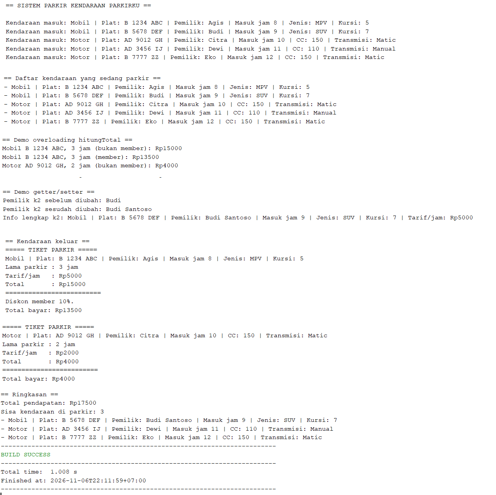
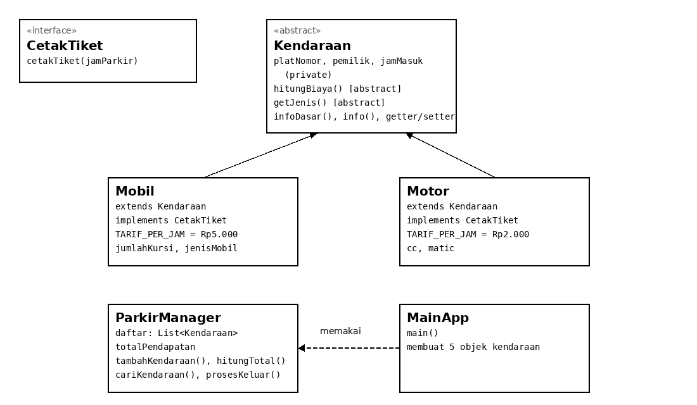

# ParkirKu — Sistem Parkir Kendaraan

Program Java untuk Lab Session 3B Praktikum Pemrograman Berorientasi Objek (OOP):
sistem parkir kendaraan sederhana yang mencatat kendaraan masuk, menghitung biaya
parkir per jam, mencetak tiket saat kendaraan keluar, dan menghitung total
pendapatan. Program menerapkan kelima konsep OOP yang diminta soal dalam satu
studi kasus yang utuh.

| | |
|---|---|
| **Mata kuliah** | Pemrograman Berorientasi Objek — Lab Session 3B |
| **Disusun oleh** | Agis Lentera Pratama (L0325016) |
| **Asisten praktikum** | Muhammad Ihsaan Al Fikri (L0324024), Hammam Ibnu Adi'Abdillah (L0324015) |
| **Program Studi** | Informatika, Fakultas Teknologi Informasi dan Sains Data, Universitas Sebelas Maret |
| **Bahasa** | Java (diuji dengan JDK 17 dan JDK 26) |
| **Status** | Selesai dan terverifikasi: compile bersih, BUILD SUCCESS, output sesuai perhitungan manual |

## Screenshot

Hasil menjalankan program di NetBeans (screenshot asli):



Diagram kelas program:



## Daftar Isi

- [Tentang Program](#tentang-program)
- [Ketentuan OOP yang Dipenuhi](#ketentuan-oop-yang-dipenuhi)
- [Tarif Parkir](#tarif-parkir)
- [Struktur Project](#struktur-project)
- [Cara Menjalankan](#cara-menjalankan)
- [Contoh Output](#contoh-output)
- [Pengujian](#pengujian)
- [Catatan](#catatan)

## Tentang Program

Tema yang dipilih adalah sistem parkir kendaraan dengan nama program
**ParkirKu**. Tema ini dipilih karena hubungan antara superclass, subclass, dan
interface di dalamnya logis dan mudah dilacak: semua kendaraan memiliki plat
nomor, pemilik, jam masuk, dan biaya parkir, tetapi Mobil dan Motor berbeda
tarif dan berbeda detailnya, dan semua kendaraan yang parkir harus bisa
mencetak tiketnya.

Alur program:

1. Lima kendaraan masuk dan dicatat (2 Mobil, 3 Motor).
2. Biaya parkir dihitung secara polimorfik, dengan dan tanpa diskon member.
3. Perubahan data pemilik didemonstrasikan melalui getter dan setter.
4. Dua kendaraan keluar, tiketnya dicetak melalui interface, dan total
   pendapatannya dihitung.

## Ketentuan OOP yang Dipenuhi

| Konsep | Implementasi | File |
|---|---|---|
| **Encapsulation** | Atribut `private` + getter/setter yang memvalidasi input (plat kosong ditolak, jam masuk hanya 0–23, jumlah kursi minimal 1, CC minimal 50) | `Kendaraan.java`, `Mobil.java`, `Motor.java` |
| **Inheritance** | 1 superclass + 2 subclass, keyword `extends`, constructor subclass memanggil `super()` | `Kendaraan.java`, `Mobil.java`, `Motor.java` |
| **Polymorphism — overriding** | `hitungBiaya()`, `getJenis()`, `infoDasar()`, `cetakTiket()` ditulis ulang dengan anotasi `@Override` | `Mobil.java`, `Motor.java` |
| **Polymorphism — overloading** | `tambahKendaraan()` dan `hitungTotal()` punya dua versi dengan parameter berbeda; `info()` dan `info(boolean)` juga | `ParkirManager.java`, `Kendaraan.java` |
| **Runtime polymorphism** | Daftar `List<Kendaraan>` berisi objek `Mobil` dan `Motor`; method yang jalan mengikuti objek sebenarnya | `ParkirManager.java`, `MainApp.java` |
| **Abstract class** | `Kendaraan` adalah abstract class dengan abstract method `hitungBiaya()` dan `getJenis()` | `Kendaraan.java` |
| **Interface** | `CetakTiket` mendeklarasikan `cetakTiket()`; `Mobil` dan `Motor` mengimplementasikannya dengan `implements` | `CetakTiket.java`, `Mobil.java`, `Motor.java` |
| **Minimal 4 class, 4 objek** | 6 file, 5 objek kendaraan + 1 objek `ParkirManager` | Semua file |

## Tarif Parkir

| Kendaraan | Tarif per jam |
|---|---|
| Mobil | Rp5.000 |
| Motor | Rp2.000 |
| Member | Diskon 10% dari total biaya |

## Struktur Project

```text
ParkirKu/
├── README.md                      # File ini
├── screenshot-hasil-run.png       # Screenshot hasil menjalankan program
├── diagram-kelas.png              # Diagram kelas program
├── CARA_MENJALANKAN.txt           # Langkah menjalankan program
├── Hasil_Run.txt                  # Output lengkap program
└── src/
    ├── interfaces/
    │   └── CetakTiket.java        # Interface: kontrak cetakTiket()
    ├── model/
    │   ├── Kendaraan.java         # Abstract superclass
    │   ├── Mobil.java             # Subclass 1 (tarif Rp5.000/jam)
    │   └── Motor.java             # Subclass 2 (tarif Rp2.000/jam)
    ├── service/
    │   └── ParkirManager.java     # Logika parkir dan total pendapatan
    └── main/
        └── MainApp.java           # Entry point, membuat 5 objek
```

## Cara Menjalankan

### Cara 1 — NetBeans

1. Buat Java Project baru dengan nama `ParkirKu` (Maven atau Ant).
2. Buat 4 package: `interfaces`, `model`, `service`, `main`, lalu salin tiap
   file `.java` ke package-nya.
3. Atur Main Class ke `main.MainApp`: klik kanan project → **Properties** →
   **Run** → kolom **Main Class** diisi `main.MainApp` → OK.
4. Jalankan dengan tombol **Run** (F6). Output tampil di jendela Output.

### Cara 2 — Terminal

```bash
cd ParkirKu
javac -d out $(find src -name "*.java")
java -cp out main.MainApp
```

> Catatan: pada project Maven NetBeans, perintah `java -cp target/classes
> main.MainApp` dari folder project juga dapat dipakai setelah `compile`
> berhasil.

## Contoh Output

Output lengkap program (juga tersimpan di `Hasil_Run.txt`):

```text
== SISTEM PARKIR KENDARAAN PARKIRKU ==

Kendaraan masuk: Mobil | Plat: B 1234 ABC | Pemilik: Agis | Masuk jam 8 | Jenis: MPV | Kursi: 5
Kendaraan masuk: Mobil | Plat: B 5678 DEF | Pemilik: Budi | Masuk jam 9 | Jenis: SUV | Kursi: 7
Kendaraan masuk: Motor | Plat: AD 9012 GH | Pemilik: Citra | Masuk jam 10 | CC: 150 | Transmisi: Matic
Kendaraan masuk: Motor | Plat: AD 3456 IJ | Pemilik: Dewi | Masuk jam 11 | CC: 110 | Transmisi: Manual
Kendaraan masuk: Motor | Plat: B 7777 ZZ | Pemilik: Eko | Masuk jam 12 | CC: 150 | Transmisi: Matic

== Daftar kendaraan yang sedang parkir ==
- Mobil | Plat: B 1234 ABC | Pemilik: Agis | Masuk jam 8 | Jenis: MPV | Kursi: 5
- Mobil | Plat: B 5678 DEF | Pemilik: Budi | Masuk jam 9 | Jenis: SUV | Kursi: 7
- Motor | Plat: AD 9012 GH | Pemilik: Citra | Masuk jam 10 | CC: 150 | Transmisi: Matic
- Motor | Plat: AD 3456 IJ | Pemilik: Dewi | Masuk jam 11 | CC: 110 | Transmisi: Manual
- Motor | Plat: B 7777 ZZ | Pemilik: Eko | Masuk jam 12 | CC: 150 | Transmisi: Matic

== Demo overloading hitungTotal ==
Mobil B 1234 ABC, 3 jam (bukan member): Rp15000
Mobil B 1234 ABC, 3 jam (member): Rp13500
Motor AD 9012 GH, 2 jam (bukan member): Rp4000

== Demo getter/setter ==
Pemilik k2 sebelum diubah: Budi
Pemilik k2 sesudah diubah: Budi Santoso
Info lengkap k2: Mobil | Plat: B 5678 DEF | Pemilik: Budi Santoso | Masuk jam 9 | Jenis: SUV | Kursi: 7 | Tarif/jam: Rp5000

== Kendaraan keluar ==
===== TIKET PARKIR =====
Mobil | Plat: B 1234 ABC | Pemilik: Agis | Masuk jam 8 | Jenis: MPV | Kursi: 5
Lama parkir : 3 jam
Tarif/jam   : Rp5000
Total       : Rp15000
=========================
Diskon member 10%.
Total bayar: Rp13500

===== TIKET PARKIR =====
Motor | Plat: AD 9012 GH | Pemilik: Citra | Masuk jam 10 | CC: 150 | Transmisi: Matic
Lama parkir : 2 jam
Tarif/jam   : Rp2000
Total       : Rp4000
=========================
Total bayar: Rp4000

== Ringkasan ==
Total pendapatan: Rp17500
Sisa kendaraan di parkir: 3
- Mobil | Plat: B 5678 DEF | Pemilik: Budi Santoso | Masuk jam 9 | Jenis: SUV | Kursi: 7
- Motor | Plat: AD 3456 IJ | Pemilik: Dewi | Masuk jam 11 | CC: 110 | Transmisi: Manual
- Motor | Plat: B 7777 ZZ | Pemilik: Eko | Masuk jam 12 | CC: 150 | Transmisi: Matic
```

## Pengujian

Pengujian dilakukan dengan menjalankan program dan membandingkan output aktual
dengan perhitungan manual (Mobil Rp5.000/jam, Motor Rp2.000/jam). Semua
skenario lolos:

| No | Skenario | Hasil Aktual Program | Status |
|---|---|---|---|
| 1 | Mobil 3 jam, bukan member | Rp15.000 (3 × Rp5.000) | Lolos |
| 2 | Mobil 3 jam, member (diskon 10%) | Rp13.500 (Rp15.000 × 0,9) | Lolos |
| 3 | Motor 2 jam, bukan member | Rp4.000 (2 × Rp2.000) | Lolos |
| 4 | Setter ubah pemilik k2 | Budi menjadi Budi Santoso | Lolos |
| 5 | Mobil B 1234 ABC keluar (member) | Tiket tercetak, total bayar Rp13.500 | Lolos |
| 6 | Motor AD 9012 GH keluar | Tiket tercetak, total bayar Rp4.000 | Lolos |
| 7 | Ringkasan akhir | Total pendapatan Rp17.500, sisa 3 kendaraan | Lolos |

Total pendapatan Rp17.500 sama dengan jumlah Rp13.500 dan Rp4.000, dan sisa
kendaraan 3 sama dengan 5 kendaraan masuk dikurangi 2 kendaraan keluar,
sehingga hasil program konsisten dengan perhitungan manual.

## Catatan

- Program memakai skenario data tetap agar outputnya dapat diperiksa angkanya
  satu per satu; belum ada input dari pengguna dan belum ada penyimpanan
  permanen.
- Penambahan jenis kendaraan baru cukup dengan membuat subclass `Kendaraan`
  dan mengimplementasikan `CetakTiket`, tanpa mengubah `ParkirManager`.
- Laporan praktikum versi Word (format Laprak PBO 3, 18 halaman) tetap
  tersedia terpisah; README ini adalah dokumentasi project-nya.
